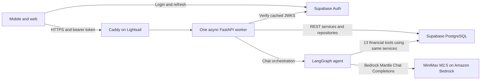

# AWS deployment for BuyWise

Prepared 2026-10-27 for a **$30/month AWS budget** and a small launch. Traffic volume and the Supabase region have not been supplied. This is a deployable single-server starting point, not a measured capacity promise or a high-availability system. AWS resources have not been provisioned by this change.

## Recommendation and cost

Start with **one Linux Lightsail instance, 2 GB RAM / 2 vCPU, public IPv4, $12/month**, running Docker Compose. Use the AWS region nearest the existing Supabase database; if that database is in Mumbai, choose Mumbai. Check the console's price and transfer allowance in that region before purchase. Model inference uses MiniMax M2.5 through Amazon Bedrock Mantle; this backend does not need a GPU. Set `BEDROCK_REGION` to the region where its API key was generated.

| Item | Monthly planning allowance (USD) |
|---|---:|
| Lightsail 2 GB Linux bundle with public IPv4 | $12 |
| Caddy HTTPS and certificate renewal | $0 software/certificate fee |
| Snapshots and optional monitoring | Reserve $3–5; usage dependent |
| Headroom for tax, transfer overruns, and operational costs | Remaining budget |

The [Lightsail pricing page](https://aws.amazon.com/lightsail/pricing/) lists the 2 GB bundle at $12 and the 4 GB bundle at $24. The smaller bundle leaves substantially more room under $30; upgrade only if measured memory/CPU use requires it. Transfer quotas vary by region, including reduced allowances in Mumbai. A registered domain is a separate annual expense; use an existing domain and its DNS hosting if available. No free-trial credits are assumed.

This estimate **excludes Supabase, Bedrock inference, domain registration, and client hosting**. If $30 means the entire product bill, first allocate database and AI usage and fit AWS into the remainder. An AWS Budget alert is a notification, not a hard spending cap. Concurrency/rate limits also do not impose a monthly AI spending cap: configure provider spending controls where available and track tokens per completed turn.

A managed ECS/Fargate service behind an ALB is the next stage, not the best fit for this budget. As a reproducible US East example at 730 hours/month, 0.5 vCPU + 1 GB x86 Fargate costs approximately $18.02 and the ALB base approximately $16.43: **$34.45 before ALB usage, public IPv4, logs, image storage, transfer, tax, or a second task**. These are reference-region figures, not a Mumbai quote. [Fargate pricing](https://aws.amazon.com/fargate/pricing/), [ALB pricing](https://aws.amazon.com/elasticloadbalancing/pricing/). ECS Express Mode provisions these underlying resources; it does not eliminate their charges. [AWS service guidance](https://docs.aws.amazon.com/apprunner/latest/dg/apprunner-availability-change.html).

## Request architecture



Normal requests authenticate a Supabase JWT, validate input, call services/repositories, and return JSON. Ownership stays in repository filters; moving hosting does not move authorization into the proxy. Keep Supabase Auth and PostgreSQL together for now: migrations reference `auth.users`, so moving only application tables to RDS would require a deliberate schema/auth redesign.

Chat is a synchronous HTTP request with asynchronous I/O. It saves the user message, loads bounded history and profile/time context, runs model → tools → model, then saves the final assistant reply and changed resource kinds. The model has a 45 s call timeout, one retry, a 4096-token response bound, and the whole agent invocation has a 60 s / 12-step bound. The whole HTTP request can take longer because authentication, setup and final persistence are outside that invocation timer.

One async worker can overlap these network waits. It does not need one worker per chat. The existing model callback releases its database connection before each model call, and a per-turn lock serializes tool operations sharing that turn's session. These behaviors are essential: holding connections during model waits would starve the REST API.

The deployment admits **four active chat HTTP requests per process** (`CHAT_MAX_CONCURRENT`). Excess requests get **503 + Retry-After: 5 before message persistence or model execution**, with no in-memory waiting queue. REST routes remain available, although all routes still share CPU and the database pool. Four is an initial safety setting, not a load-test result. At average turn duration T seconds, four slots sustain roughly `4 / T` admitted chats per second; provider quotas, DB activity and memory can lower that rate. Tune after observing real usage.

The server pool here is 5 connections + 2 overflow. Budget connections as `replicas × workers × (pool size + overflow)` plus migrations/admin/other applications. Session pooling still consumes database capacity; check the actual project limits. Use the **Supabase session pooler on port 5432** on IPv4 hosts. The transaction pooler on port 6543 is not a drop-in change for this asyncpg setup. [Supabase connection guidance](https://supabase.com/docs/guides/database/connecting-to-postgres).

## Files and runtime behavior

- Root `Dockerfile`: Python 3.11, `uv.lock` with `uv sync --locked --no-dev`, non-root runtime, no development server. `.dockerignore` allows only backend/build inputs, excluding credentials, clients, Git history and local environments.
- `ai_service/serve.py`: one Uvicorn worker, required configuration check, access logging off, 100 s graceful shutdown. Existing request logs expose timing/counts without SQL, bodies or credentials.
- `deploy/aws/compose.yaml`: API has no published port; only Caddy publishes 80/443. API filesystem is read-only except temporary storage; logs rotate; containers restart on process exit. Docker health checks report health but do not automatically restart a hung process.
- `deploy/aws/Caddyfile`: automatic HTTPS, 1 MB request-body bound and 85 s upstream response-header timeout. No automatic retries of financial writes.
- `DB_SSL_VERIFY=true` verifies PostgreSQL's certificate chain and hostname, including Alembic connections. If verification fails, install the appropriate trusted CA; do not disable verification to get a deployment through.
- `CORS_ALLOW_ORIGINS` is a JSON list of exact web origins, without trailing slashes. Native mobile calls do not depend on CORS. Authentication remains mandatory regardless of origin.

## First deployment

1. Create a Linux Lightsail instance in the chosen region and attach its static IPv4 address. Enable automatic security updates. Allow incoming TCP 80/443; restrict SSH to your administrator IP. Keep 8000 closed. The API needs outbound HTTPS to Supabase and the configured Bedrock region, plus outbound TCP 5432 to the session pooler. Do not add RDS, a NAT Gateway, Redis, Kubernetes, or an ALB for this initial single-host deployment.
2. Install Docker Engine and **Docker Compose plugin 2.30 or newer** from [Docker's official instructions](https://docs.docker.com/engine/install/ubuntu/). Configure the Docker service to start on boot. Compose's raw env-file support preserves literal `$` in secret values.
3. Point the API domain's DNS A record to the static IPv4 address. Remove an AAAA record unless IPv6 actually reaches this instance. Configure DNS as a direct record for initial validation; any later CDN/proxy needs compatible chat timeouts.
4. Transfer/clone the reviewed repository to the host. Copy `deploy/aws/.env.example` to `deploy/aws/.env`, restrict it to the administrator (`chmod 600 deploy/aws/.env`), and fill in real values on the host. This file is ignored by Git and excluded from the image. Do not source it as shell code. Use the URL-encoded session-pooler password. Use backend-only service credentials for account deletion.
5. Build on the host initially, or preferably build the same image in CI and transfer/pull it to avoid build memory pressure on 2 GB. Give each release a unique `BACKEND_IMAGE` tag. Store the Bedrock API key only in the server's protected `.env`; its configured region must match the key's region. The application does not need separate AWS access-key credentials when using this Bedrock API key.

Run from the repository root on the deployment host:

```bash
docker compose --env-file deploy/aws/.env -f deploy/aws/compose.yaml build api
# Inspect revision first. Existing production data must already have the expected migration history.
docker compose --env-file deploy/aws/.env -f deploy/aws/compose.yaml run --rm --no-deps api alembic current
# Take a database backup and review pending migrations before applying them once per release.
docker compose --env-file deploy/aws/.env -f deploy/aws/compose.yaml run --rm --no-deps api alembic upgrade head
docker compose --env-file deploy/aws/.env -f deploy/aws/compose.yaml up -d
docker compose --env-file deploy/aws/.env -f deploy/aws/compose.yaml ps
```

Migrations run as a **separate release step**, never automatically on every API startup. Do not reset or stamp an existing populated database to get past a migration error. Current head is `004`; validate it against the target database. This deployment adds no schema migration. The Compose environment forces `ENVIRONMENT=production` for API and migration containers so developer endpoints stay disabled.

After starting, check `https://YOUR_API_DOMAIN/health/live` gives 200, HTTP redirects to HTTPS, and `/docs`, `/openapi.json` and `/api/v1/dev/token` are unavailable. This probe checks the process only; it does **not** prove database or Bedrock readiness. With a test user, verify profile, transactions, dashboard, a read-only AI request and a controlled AI write. Test a real retry with the same idempotency key; check that it returns the original result. Do not paste access tokens or the Bedrock API key into logs, tickets or shared terminal histories.

Set `EXPO_PUBLIC_API_URL` and `NEXT_PUBLIC_API_URL` in the clients to the HTTPS API origin and rebuild/redeploy them. The mobile chat request timeout is 90 s, leaving room around the agent's 60 s execution budget; ordinary mobile API requests remain 15 s. The current web client has no explicit fetch timeout. These changes do not introduce a new API response shape.

## Operations and release safety

- Start with billing alerts at $20/$25/$30 and instance CPU/burst-capacity, memory, disk, health and 5xx monitoring. Lightsail's built-in metrics do not cover process memory; install a host metrics agent if needed and include any CloudWatch charges in the budget. An external HTTPS monitor should alert on downtime.
- Watch REST and chat latency separately, chat saturation 503s, DB timeout 503s, failed assistant turns, Bedrock throttles/tokens, and free disk. Chat execution errors currently persist a friendly error reply and can return HTTP 200, so 5xx counts alone miss those failures.
- The standard request log deliberately omits `/health/live`; rotating local logs do not survive instance loss. Set bounded centralized retention if incident investigation requires it. Avoid verbose provider/SQL debugging with financial data.
- Keep Supabase backups enabled and test restoring them. Lightsail snapshots protect host configuration and Caddy's certificate volume, not the external database. Protect snapshots that contain credentials.
- Before updates, build/tag the new image without overwriting the previous tag. Apply only reviewed compatible migrations. Recreate the API with the new tag; the 110 s container grace period exceeds Uvicorn's 100 s draining period. This is a single instance: short deployment downtime is possible. Never use an aggressive five-second drain for chat.
- Roll back application code by setting `BACKEND_IMAGE` to the retained previous tag and running `up -d --no-build --no-deps api`. Keep database migrations compatible with both versions; an image rollback does not roll back the database. Never run `down -v` during routine releases because it deletes certificate volumes.
- Check live health after host reboot and each release. Restrict `.env`, SSH and backup access. Rotate secrets after suspected exposure. If the host is rebuilt, retrieve configuration through a controlled secret-storage process.

## Reliability limits and growth path

The single host is a deliberate cost tradeoff: host or zone failure causes downtime. No capacity or reliability guarantee is possible until the image, HTTPS, database, provider quotas and concurrent traffic are verified on the target host.

Current chat limitations predate AWS: a process crash can leave a committed user message permanently returning 409 for its key; retrying with a new key can duplicate writes already performed. Transaction tools have per-turn idempotency keys, but `add_goal` does not. Budget/progress tools write absolute values. Concurrent requests to the same conversation are not serialized across turns. The app also returns completed idempotent replays through the same admission gate, so even a replay can receive a busy 503. Do not claim end-to-end exactly-once financial execution or durable job recovery. After a server crash, inspect the conversation and ledger before creating a replacement send. Durable recovery requires a separate design with job states/leases, idempotent writes for every tool, and tests.

Rate limits and chat capacity are **process-local**. Token refresh creates a new rate-limit key. Multiple workers/replicas multiply the available limits and pool sizes; do not scale by simply setting a large worker count. Rate controls limit bursts but do not replace per-user AI cost quotas or abuse monitoring.

When usage or availability needs justify a higher budget:

1. Move this container to ECS/Fargate with an ALB and at least two tasks across zones. Set the ALB idle timeout to 120 s and task stop timeout to 120 s, with deregistration delay long enough to drain chat. Recalculate maximum DB connections including tasks temporarily overlapping during deployments. Put the API behind the ALB security group only.
2. Add shared rate-limit storage and authenticated-user quotas before increasing replicas. Consider a separately sized chat service using the same backend code if chats interfere with REST latency.
3. Add SQS + a worker only for workflows that must survive disconnects/restarts or exceed an HTTP deadline. Persist job/turn status and idempotent tool execution first; use polling or streaming status in both clients. Do not put current chat work in an untracked FastAPI background task or send SQS jobs without changing its API/client contract.

A generic HTTP API Gateway path is a poor default for the existing non-streaming chat because its 30 s integration timeout is shorter than the agent turn. [AWS HTTP API quotas](https://docs.aws.amazon.com/apigateway/latest/developerguide/http-api-quotas.html). Lambda can support other designs, but adapting this pooled async application and response contract offers little benefit for this launch. AWS App Runner is closed to new customers; AWS points users toward ECS Express Mode instead. [AWS announcement](https://docs.aws.amazon.com/apprunner/latest/dg/apprunner-availability-change.html).

## Verification of this change

The backend image built successfully from the committed dependency lockfile. A local container with dummy credentials, outbound networking disabled, a read-only filesystem, dropped capabilities and UID 10001 passed liveness, production-route exclusion and secret/client-source exclusion checks, then shut down cleanly. The Compose file parsed with a current Compose plugin and placeholder values; Caddy validated the proxy file without obtaining a certificate. Backend tests: 216 passed, 43 PostgreSQL-dependent tests skipped. Mobile unit-test command, typecheck and lint passed. Both root and mobile AGENTS/CLAUDE pairs match.

These checks do not verify AWS networking, public DNS/TLS issuance, live Supabase TLS/authentication, migrations against the deployment database, live Bedrock calls, device behavior or production load. Complete the test-user smoke checks above and exercise concurrent chat plus ordinary API traffic on the target host before launch.
